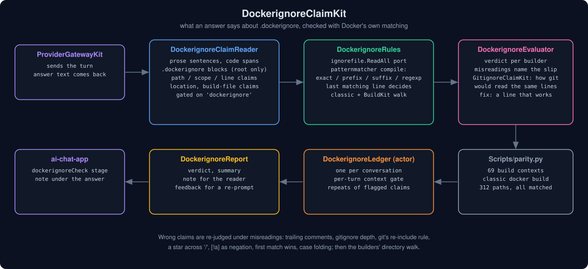
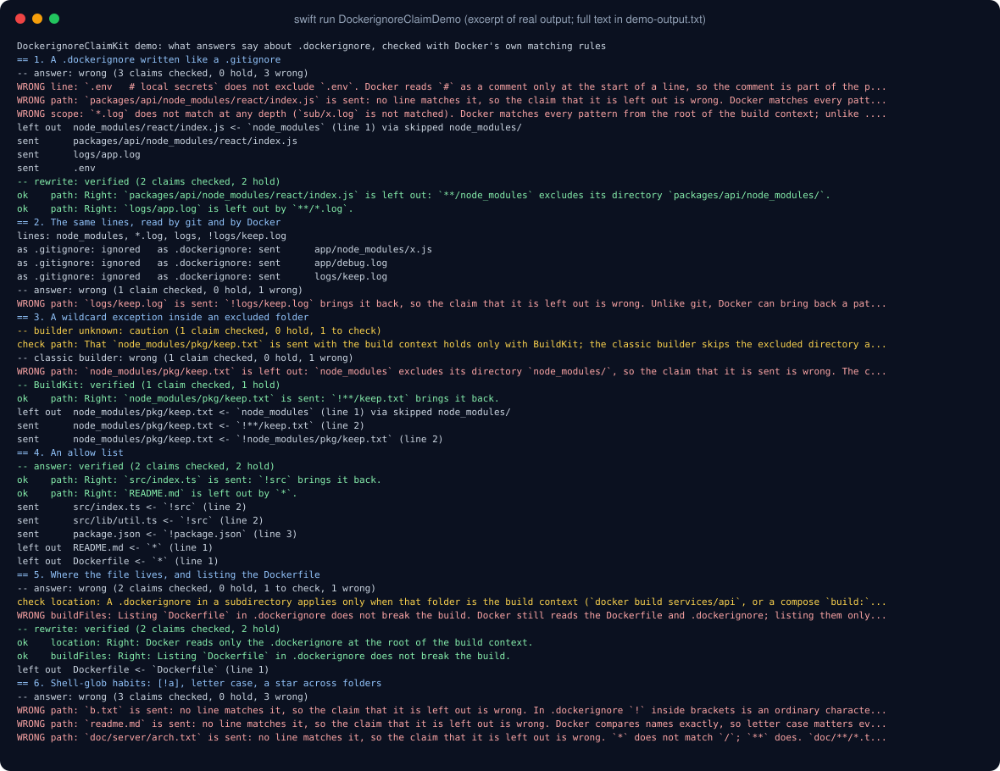
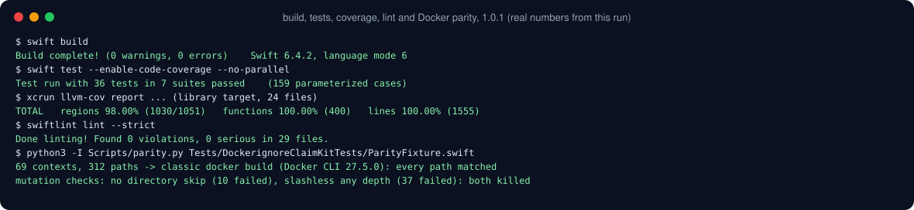

# DockerignoreClaimKit



Ask a model for a `.dockerignore` and it often writes the file the way it would write a `.gitignore`:
`node_modules`, `*.log`, `.env  # local secrets`, then says `node_modules` is left out of every package and
`*.log` catches log files at any depth. Docker reads none of that the way the answer says. It matches every
pattern from the root of the build context, so `node_modules` and `*.log` only match at the top; `#` starts a
comment only at the start of a line, so the `.env` line excludes nothing; and the classic builder searches an
excluded directory only for exceptions whose text starts with its path, so `!**/keep.txt` cannot bring back
`node_modules/pkg/keep.txt`. Other answers put a `.dockerignore` in each service folder (Docker reads only the
one at the root of the context), warn that listing the `Dockerfile` breaks the build (it does not), or carry
the git rule that nothing below an excluded directory can come back (in Docker it can).

DockerignoreClaimKit reads what an answer says about `.dockerignore` rules, in its prose and in the
`.dockerignore` it shows, and applies Docker's own matching to each claim: a port of the Docker CLI's
`ignorefile.ReadAll` and `moby/patternmatcher` (white space trimmed, `filepath.Clean`, the pattern compiled to
an exact, prefix, suffix or regular-expression match, the last matching line deciding, a line matching a parent
directory too), plus the directory walk of each builder. It says which claims hold, which are wrong, the mistake
behind each wrong one, and a line that does what the answer meant.

## Why

The series' claim checkers recompute what an answer works out on its own: dates, arithmetic, units, regexes,
strings, JSON, YAML, TOML, SQL, version ranges and `.gitignore` rules. A `.dockerignore` is a claim of the same
kind, and its mistakes cost something: a `node_modules` folder or a `.env` file that was meant to stay out is sent
to the builder and copied into the image by `COPY . .`, or a file that was meant to come back is missing at
build time. Most of the mistakes come from one habit, reading the file with `.gitignore`'s rules, so the
checker also asks [GitignoreClaimKit](https://github.com/rajatslakhina/gitignore-claim-kit) how git would have
read the same lines.

## What it checks

| Claim | Example | Read from |
|---|---|---|
| path | "This excludes `packages/api/node_modules/x.js`", "`logs/keep.log` is still sent" | prose, against the answer's `.dockerignore` or the patterns the sentence names; a `!` line naming a path |
| scope | "`*.log` matches at any depth", "`build` only matches at the root of the context" | prose |
| line | `.env   # local secrets` | the lines of a `.dockerignore` |
| location | "Put a `.dockerignore` in each service folder" | prose |
| build files | "Listing the `Dockerfile` in `.dockerignore` breaks the build" | prose |

### The slips it names

A wrong path claim is re-judged under misreadings of the file; the first one under which it holds names the
mistake, and comes with a fix where there is an obvious one.

| Slip | The misreading | Fix |
|---|---|---|
| `trailingComment` | `.env  # secrets` read as a pattern and a comment | `.env` on its own line |
| `rootRelative` | `node_modules` read as matching at every level, as in `.gitignore` | `**/node_modules` |
| `exceptionReincludes` | git's rule that an excluded directory is final; Docker brings the path back | |
| `starStopsAtSlash` | `doc/*.txt` read as matching `doc/a/b.txt` | `doc/**/*.txt` |
| `bangInBracket` | `[!a]` read as "not `a`"; in `.dockerignore` `!` is a plain character there | `[^a]` |
| `lastMatchWins` | an earlier line read as deciding | |
| `letterCase` | names compared without case; Docker compares them exactly, even on macOS | |
| `skippedDirectory` | a wildcard exception the classic builder never sees | `!` plus the path |
| `gitignoreRules` | anything else that holds under git's reading of the same lines | |
| `nestedIgnoreFile` | a `.dockerignore` in a subdirectory read as applying there | |
| `buildFilesStillRead` | listing the `Dockerfile` or `.dockerignore` read as breaking the build | |

### Two builders

The classic builder (`docker build` without buildx) and BuildKit read patterns the same way. They differ in
when an excluded directory is searched for exceptions. The classic builder searches it only when an exception's
text starts with the directory's path, so `!node_modules/pkg/keep.txt` works and `!**/keep.txt` does not. BuildKit
(as `tonistiigi/fsutil` reads) searches every excluded directory as soon as any exception holds a wildcard. A claim
that holds under one and not the other is a caveat unless the policy names the builder.

## Install

```swift
.package(url: "https://github.com/rajatslakhina/dockerignore-claim-kit.git", from: "1.0.0")
```

and `.product(name: "DockerignoreClaimKit", package: "dockerignore-claim-kit")` in your target. Swift 6; it
depends on GitignoreClaimKit. macOS 13, iOS 16, tvOS 16, watchOS 9.

## Usage

~~~swift
import DockerignoreClaimKit

let answer = """
Add this to your `.dockerignore`:

```
node_modules
.env   # local secrets
```

This excludes `node_modules` in every package, so `packages/api/node_modules/x.js` is never sent.
"""
let report = DockerignoreClaimChecker().check(answer)
report.verdict              // .wrong
report.summary              // "2 claims checked, 0 hold, 2 wrong"
report.note                 // "Dockerignore check: `.env   # local secrets` does not exclude `.env`. ..."
report.feedback             // a re-prompt listing each correction
report.findings.map(\.fix)  // [".env", "**/node_modules"]

// Docker's verdict on one path, for each builder.
let rules = DockerignoreRules("node_modules\n!**/keep.txt\n")
rules.verdict(for: "node_modules/pkg/keep.txt", builder: .classic).isExcluded        // true
rules.verdict(for: "node_modules/pkg/keep.txt", builder: .classic).skippedDirectory  // "node_modules/"
rules.verdict(for: "node_modules/pkg/keep.txt", builder: .buildKit).isExcluded       // false

// A sentence's own patterns are read only when .dockerignore is in view.
let checker = DockerignoreClaimChecker()
checker.check("`*.log` matches `logs/a.log`.").verdict                                        // .noClaims
checker.check("`*.log` matches `logs/a.log`.", context: "Is my .dockerignore right?").verdict  // .wrong

// Across a conversation, a wrong claim stated again is marked as repeated.
let ledger = DockerignoreLedger()
_ = await ledger.review("`node_modules` excludes `app/node_modules/x.js`.", context: "My .dockerignore?")
let again = await ledger.review("Yes, `node_modules` excludes `app/node_modules/x.js`.")
again.repeatedCount  // 1
~~~

The example is a test (`ReadmeTests`).

### Policies

| Policy | Lines of a `.dockerignore` as claims | Builder | Caveats |
|---|---|---|---|
| `.standard` | yes | unknown: a claim that depends on it is a caveat | reported |
| `.lenient` | no | unknown | let through |
| `.classic` | yes | the classic builder | reported |
| `.buildKit` | yes | BuildKit | reported |

## Only when .dockerignore is in view

A sentence such as "`*.log` matches `logs/a.log`" is true for `.gitignore` and false for `.dockerignore`, and
"`[a-z]+` matches `abc`" is about neither. Claims that rest only on a sentence's own patterns are read only when
the answer, or the `context` a caller passes (the question), names `.dockerignore`. In an answer that also talks
about `.gitignore` or another ignore file, a sentence is read only if it names Docker, the build context or the
image. A `DockerignoreLedger` decides this per turn: a later turn that names no ignore file keeps only claims that
repeat one already flagged. Sixteen sentences from other domains (regexes, globs, routes, `compactMap`, `COPY`,
`.gitignore`, `.npmignore`) are kept as a test, and all make no claim.

## How it fits

- **ProviderGatewayKit** sends the turn; this package checks the answer that comes back. It has no compile-time
  dependency on it: run it on the reply text before the answer is shown.
- **GitignoreClaimKit** reads `.gitignore` rules; this package asks it how git would read the same lines, to name
  the `gitignoreRules` slip. GitignoreClaimKit leaves `.dockerignore` claims unchecked; this package checks them.
- **OutputRepairKit** runs a bounded repair loop; `report.feedback` is the re-prompt.
- **ai-chat-app** runs it as the `dockerignoreCheck` stage after the model answers.

## Demo



`swift run DockerignoreClaimDemo` runs eight scenarios: a `.dockerignore` written like a `.gitignore` (wrong,
then the `**/` rewrite), the same lines read by git and by Docker, a wildcard exception inside an excluded folder
under each builder, an allow list (`*` then `!src`), where the file lives and listing the `Dockerfile`, shell-glob
habits (`[!a]`, letter case, `*` across folders), a line Docker rejects, and a conversation through a
`DockerignoreLedger` where one wrong claim comes back after an unrelated answer about a regex. The full output is in
[Screenshots/demo-output.txt](Screenshots/demo-output.txt); two runs are byte-identical.

## Quality



- `swift build`: 0 warnings, 0 errors (Swift 6.4.2, language mode 6).
- `swift test --enable-code-coverage --no-parallel`: 34 tests in 7 suites (160 parameterized cases), 0 failures.
- `llvm-cov report`: **100.00% of lines (1550) and functions (399) on all 24 library files**; regions 98.00%
  (1028 of 1049). Per-file numbers are in [Screenshots/coverage.txt](Screenshots/coverage.txt).
- `swiftlint lint --strict`: 0 violations in 29 files, with the series' `.swiftlint.yml` unchanged.
- **Parity with Docker.** `Scripts/parity.py` builds 69 throwaway build contexts (312 paths), runs the classic
  `docker build` on each with `FROM scratch` and `COPY . /ctx/`, reads which files reached the image, and writes
  `ParityFixture.swift`. Docker CLI 27.5.0 wrote the fixture; every path matched on the first run. The contexts
  cover root-only matching, `**` in every position, trailing slashes and comments, exceptions inside excluded
  directories (literal, `**/`, `dir/*/`), allow lists, `[!a]` and `[^a]`, escapes, `^`, `{`, `+`, CRLF and a byte
  order mark, letter case, an excluded `Dockerfile` and `.dockerignore`, a nested `.dockerignore`, and three files
  Docker rejects (`[a`, `!`, a trailing `\`). Turning the parity check upside down fails 303 expectations.
- **Mutation checks**, each killed by `swift test`'s exit status: the classic builder never skipping a directory
  (10 failed expectations), and slashless patterns matching at any depth (37).
- **Probes before tagging**: 14 correct answers stay unflagged, 10 wrong ones are caught with the right slip, 3
  `.gitignore` answers and 16 other-domain sentences make no claim, an answer showing both files is judged only on
  its `.dockerignore`, and a later regex turn in the same conversation stays quiet.
- BuildKit's directory walk is taken from `tonistiigi/fsutil`'s source (`filter.go`), not run: buildx is not
  installed where this was built.

## Limits

- Docker's regular-expression quirks are modelled for plain brackets (`[a-c]`, `[^a]`, `[!a]`), `^` and escaped
  punctuation. A bracket holding `*`, `?`, `[` or `\`, a reversed range, or `\` before a letter is left unchecked.
- Only code spans are read: "the logs folder" in plain prose is not a path. "`X` but not `Y`" checks `X` only.
- A clause is read only up to "if", "unless", "when" or "otherwise", and advice ("should", "to exclude", "can")
  is not a claim.
- The checker answers what reaches the build context. Files a `RUN` step creates, multi-stage `COPY --from`, and
  `<Dockerfile>.dockerignore` (BuildKit's per-Dockerfile file) are not modelled; a `.dockerignore` in a
  subdirectory is assumed not to be the context root.
- `Dockerfile` is taken to be the default name at the root of the context.

## Part of a series

One of a set of Swift packages around
[ProviderGatewayKit](https://github.com/rajatslakhina/foundation-model-provider-gateway); the
[umbrella demo](https://github.com/rajatslakhina/llm-ecosystem-demo) runs them together and
[ai-chat-app](https://github.com/rajatslakhina/ai-chat-app) uses them in a real send pipeline.

MIT license.
